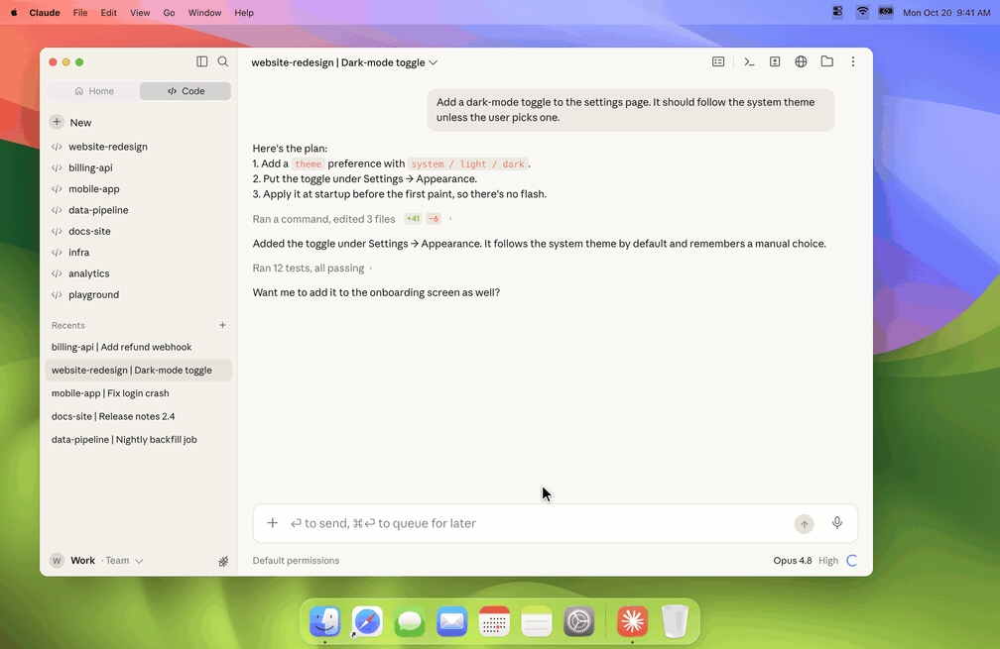
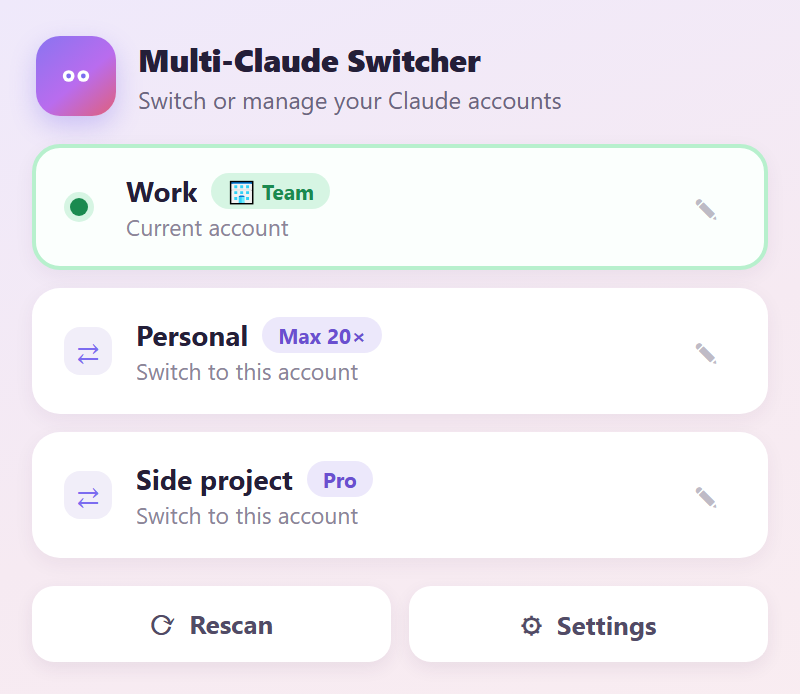

# Multi-Claude Switcher


一鍵切換多個 Claude 桌面版帳號，免去繁瑣的登入登出。對話紀錄無縫同步，讓你的開發流程不被打斷。

[](https://github.com/miou1107/multi-claude-switcher/releases/latest)
[](LICENSE)
&nbsp; [English](README.md) | **繁體中文** &nbsp;·&nbsp; [官網](https://miou1107.github.io/multi-claude-switcher/zh-tw/)

---

<p align="center">
  <br />
  <sub>macOS 的畫面；Windows 版在右下角系統匣。</sub>
</p>

---

## 為什麼你需要這個工具？

通常 Claude Desktop 一次只支援使用一個帳號，所以在這兩種情況下你會特別痛：

- **額度用盡**：A 帳號額度用完了，想換 B 帳號繼續寫 Code。
- **公私分明**：公司的專案和自己個人 Side Project，不想全部都混在同一個帳號中。

如果要手動切換帳號的話，你得要先登出再重新登入另一組帳號，而且等它跑完後會發現 **側邊對話紀錄空了**，
因為那些紀錄是跟著上一個帳號走的。

**這個工具就是來解決這件事的：**

1. **一鍵秒切**：點系統匣的常駐圖示可秒切多帳號。
2. **永遠登入**：每個帳號都各自保持登入狀態，切換時完全不用重新輸入帳密。
3. **對話紀錄各自保留**：每個帳號的 Code 對話紀錄互不影響，單純切換不會動到任何 session 資料。
4. **跨帳號對話紀錄同步**：當然你也可以勾選自動同步(或手動同步)，讓所有帳號的對話紀錄保持一致，方便你跨帳號開發。


---

## 安裝

> ⚠️ **Windows用戶重要提醒**
> 你必須使用**獨立安裝版**的 [Claude Desktop](https://claude.com/download)。
> **Microsoft Store 版不支援**：如果你是從 Microsoft Store 安裝 Claude Code，可能會因其沙盒限制而無法正常使用。
>  建議你從 Claude 下載官方 .exe 獨立安裝版。

**macOS**
> macOS使用者推薦使用 brew 指令安裝，快速又方便!
```bash
brew install --cask miou1107/tap/multi-claude-switcher
```

或是到[最新版本](https://github.com/miou1107/multi-claude-switcher/releases/latest)下載 `Multi-Claude-Switcher_<版本>_macos.zip`，解壓縮後把 **Multi-Claude Switcher.app** 拖進**應用程式**。

*只有第一次要做。* 目前 app 沒有Apple Developer 公證簽章，所以安裝時可能會被擋。
請開啟macOS的**系統設定 → 隱私權與安全性**往下捲，按**強制打開**就能完成安裝並正常使用。

或者可以直接用終端機指令來強制開啟，就能正常安裝使用：

```bash
xattr -dr com.apple.quarantine "/Applications/Multi-Claude Switcher.app"
```

**Windows**

到[最新版本](https://github.com/miou1107/multi-claude-switcher/releases/latest)下載 `Multi-Claude-Switcher_<版本>_windows_setup.exe` 執行。只會裝給目前這個使用者，不需要系統管理員權限。裝完從**開始選單**開 **Multi-Claude Switcher**。

**自動更新**

裝好之後有新版會在背景自動更新，更新時不會問你，裝好之後右下角會有一則通知。自己按「檢查更新」的話一定有回應：已經是最新版會直接告訴你，有新版就馬上更新。

## 介面語言

面板會跟著電腦的語言顯示：台灣、香港、澳門是繁體中文，中國大陸與新加坡是簡體中文，其他語言是英文。想自己指定，就到「設定」的「語言」挑一個，選過之後會記住。

只有介面的文字會翻譯。帳號名稱、你自己打的字、資料夾路徑與問題回報的內容都維持原樣。

## 怎麼用

安裝完成後，請在 macOS 選單列或 Windows 系統匣上找尋眼睛圖示，
點一下，功能面板就會打開。每個畫面右上角都有 ×，按下去或按 Esc 都可以關掉面板。

面板上會顯示你的帳號清單，並標出你現在在用哪個。可隨時切換到不同帳號，切換後 Claude Desktop
會自動用你選的帳號重開。切換進行中，面板會顯示一張進度卡，切好了會寫現在在哪個帳號，切換失敗會直接寫原因。
同步、合併、備份也用同一張進度卡，卡片還在的時候面板不會自己關掉。

**Rescan** 會找出這台電腦上登入過的 Claude 帳號，勾選之後就加進清單。每個帳號同一行右邊的板手按鈕裡有
**Change name（改名）** 跟 **Remove from list（從清單移除）**，選單直接在同一行打開，不會跳到別的畫面。

**Change name**：同一行會變成可以打字的欄位，就地改名，Enter 存檔，Esc 取消。

**Remove from list**：會先問你確認。移除是把這個帳號的設定檔資料夾封存起來，不是刪掉，隨時可以從 Settings 打開封存資料夾；
之後要再用這個帳號，重新登入一次即可。清單只剩一個帳號時不會出現這個選項。Claude 正開著的那個帳號要先切到別的帳號才能移除，
所以移除其他帳號不用先關 Claude。Windows 市集版（Store 版）另外有三種情況不給移除：正在用唯一共用槽位的帳號、
切換器還沒掃描過槽位狀態的安裝、對話還在排隊搬進剛加入的新帳號。移除完會回到帳號清單，上面有一行完成訊息；
移除失敗，或是成功但留下沒清乾淨的東西，才會另外看到說明原因的畫面。

**Settings** 有兩個開關：切換時自動同步對話紀錄、開機自動啟動。**More** 子選單裡是帳號之間同步、手動備份、
備份資料夾、封存資料夾，最後是結束程式。最下面的版號旁邊可以檢查更新和回報問題，點版號可以看每一版改了什麼。

關面板：按 **Esc** 或點面板外面。Windows 上再點一次系統匣圖示也會關；對圖示按右鍵有 **Quit**，面板打不開的時候用它結束程式。

## 對話紀錄同步

切換帳號和對話紀錄同步是兩個不同的功能。**單純切換完全不會動到 session 資料。** 如果你只是要在帳號之間
跳來跳去，不需要讓對話紀錄在兩個帳號間同步，那這一段可以直接跳過。

要讓對話跟著帳號走，有兩種做法：

**Sync sessions**：把一個帳號的 Code session 複製到另一個帳號，不改變目前使用中的帳號。複製前會先備份目標帳號，做完再回到原本的帳號。

**切換時自動同步**：預設關閉。打開之後每次切換都會把兩邊的 session 雙向合併，久了兩個帳號的紀錄就一致。
第一次打開會警告一次，因為合併過去的東西，關掉開關也不會退回來。

兩種做法都一樣：同一筆對話兩邊狀態不同時，保留較晚更新的那一份，另一份會回報給你，不會默默丟掉。
每次寫入前都先做一份加時間戳記的快照，快照失敗這次就不寫。

同步的只有 Code 分頁的對話**清單**。一般聊天的對話存在 Anthropic 伺服器上、每個帳號各一份，本機動不了。
Code 的對話內容存在另一個地方，Claude Code 會照自己的保留期清掉舊的，所以清單上有一筆、點進去卻沒有內容，
是 Claude 自己的例行整理，這個工具不會造成、也救不回來。

## Team 帳號和其他帳號一樣可以同步

這份文件以前寫「Team 帳號的對話只能匯出、不能匯入」。那是錯的，錯在這個工具本身。

對話在硬碟上照「帳號」加「組織」兩層歸檔。舊版同步只把帳號那層換成目標帳號，組織那層還是來源帳號的，
檔案完整放進了目標帳號永遠不會讀的位置，看起來就像 Team 帳號拒絕匯入。現在兩層都會換，匯入 Team 帳號的對話會落在它真的會讀的位置，
Team 帳號不需要任何特殊處理，之前針對 Team 帳號的警告也拿掉了。

[想看修正前後分別實測了什麼 →](docs/team-accounts.md)

## 回報問題

Settings 最下面的 **Report a bug** 會列出切換器知道的機器資訊：版本號、每個帳號在硬碟上的狀態、每個 log 檔最後的內容。
按 **Report a problem** 會把這份報告複製到剪貼簿，並打開一個預先填好的 GitHub issue 頁面讓你貼上。

沒有任何東西會自動送出：你先看到完整報告，貼上、送出都是你自己的帳號動手。
Email、帳號 ID、使用者名稱和家目錄路徑在報告顯示之前就換成 `account-1`、`org-A` 這種代稱，看得出對應關係，真正的值不會離開你的電腦。
換完代稱還會再掃一次，把任何看起來像 email 或帳號 ID、卻沒被換掉的東西直接塗黑。Issue 是公開的。

## 常見問題與救援

**Q：清單上為什麼只看到一個帳號？**
打開面板點 **Rescan**，勾選要管理的帳號。還沒登入過的帳號也會列出來：先勾選、切換過去，再在 Claude Desktop 裡登入。

**Q：Rescan 出現「Signed out in Claude Desktop」而且勾不動？**
那個帳號是在 Claude Desktop 裡登出的，登出會清掉那個資料夾唯一的一組登入資料，對話其實都還在硬碟上。
點 **Recover**，取個名字，在跳出來的 Claude 視窗裡登入一次，對話會自己回來。

要避免這種狀況，加帳號請用面板裡的 **＋ Add another account**，不要在 Claude Desktop 裡登出，每個帳號一開始就有自己獨立的設定檔。

**Q：（Windows）切過去、登入之後，怎麼又回到另一個帳號？**
請更新到最新版。用 Google 登入時，瀏覽器會用一個連結把結果交回 Claude；Windows 預設把這個連結交給預設帳號，除非切換器先把它導到別的帳號。
舊版只替從來沒登入過的帳號導，所以被要求重新登入的帳號沒被導到。

**Q：（Windows）Claude 自己更新完，怎麼跑到另一個帳號？**
Claude Desktop 更新完重開時沒有指定帳號，所以會開預設帳號。切換器會發現，跳出視窗問你要不要切回更新前的帳號；
你自己在切換器裡選預設帳號的話，它不會幫你切走。

**Q：（Windows）面板打不開怎麼辦？**
通常是你的電腦缺了 WebView2 套件。對系統匣的眼睛圖示按右鍵選 **Quit**，請自行安裝好 WebView2 之後再重開 (理論上 Win10 21H2 版本都有內建)。

**Q：我的對話紀錄亂掉了，救得回來嗎？**
可以。Settings → **Open backup folder**，裡面是按設定檔分開、加了時間戳記的快照，另外有一個 `tidied-` 開頭的資料夾，
放的是舊版本存錯位置、任何帳號都打不開的對話。每個帳號保留最近五份快照，更舊的移到旁邊的 `.trash` 資料夾，
放滿 30 天才真正刪除，所以有一個月可以拿回來。你自己放進那個資料夾的東西不會被動到。

**Q：log 在哪裡？**
在 `~/.multi-claude-switcher/logs/`。每個 log 的最後幾行也會一起放進 bug report，通常那樣就夠了。

**Q：如何徹底移除？**

- **macOS**：刪掉 app，再清掉 `~/.multi-claude-switcher/` 和
  `~/Library/LaunchAgents/com.miou1107.multi-claude-switcher.plist`。
- **Windows**：從「新增/移除程式」解除安裝，再刪掉 `%USERPROFILE%\.multi-claude-switcher`。

移除本工具完全不會影響你原本的 Claude Desktop 帳號與資料。

---

## 參與開發與授權

[從原始碼建置 →](docs/building.md) ·
[CLI 參考 →](docs/cli.md) ·
[運作原理 →](docs/how-it-works.md)

`FILELIST.md` 說明 repo 裡的每個檔案，`CHANGELOG.md` 是版本紀錄。

授權條款：[MIT](LICENSE)。

**免責聲明**：本專案與 Anthropic 無任何隸屬關係。工具的運作原理只是讓 Claude Desktop
對著不同的本機資料目錄啟動，並在它們之間複製 session 檔案；它不會碰到你的登入憑證，
更不會上傳任何東西。
請自行判斷、斟酌使用本專案程式碼，作者不提供任何承諾與保障，任何風險及後果由使用者自行承擔。
